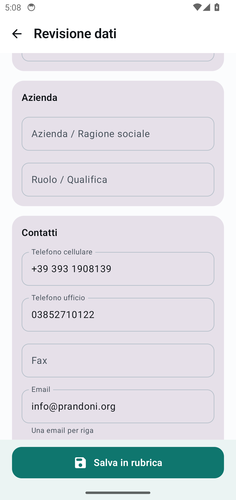
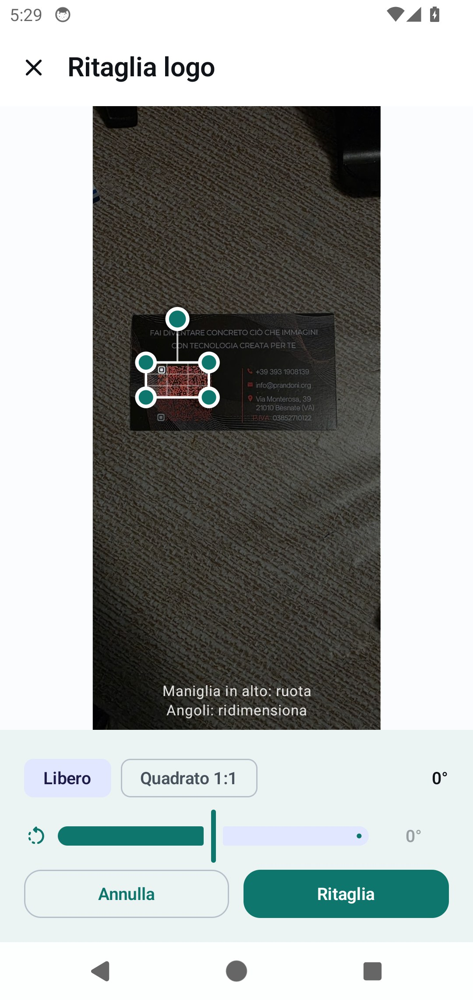
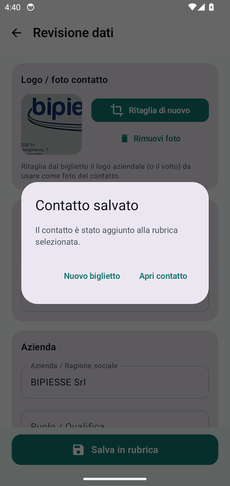

# Business Card Scanner — Android

App Android nativa in **Kotlin + Jetpack Compose** per digitalizzare i biglietti da visita: scatti
una foto (o importi un'immagine dalla galleria), il testo viene letto **interamente sul
dispositivo**, i dati vengono classificati automaticamente, puoi correggerli, ritagliare il logo
dal biglietto e salvare il contatto nella rubrica scegliendo l'account di destinazione.

Nessun server, nessun account dell'app, nessun dato del biglietto inviato in rete.

| | |
|---|---|
| **Versione** | `0.3.0-beta` (beta, APK release firmato) |
| **Requisiti** | Android 8.0+ (`minSdk 26`) · `targetSdk 35` |
| **APK** | ~54 MB release firmata (modello OCR incluso, nessun download a runtime) |
| **Lingua UI** | Italiano |
| **Stato** | Beta — flusso completo funzionante e verificato su emulatore API 34 |

---

## Indice

- [Screenshot](#screenshot)
- [Funzionalità](#funzionalità)
- [Come funziona](#come-funziona)
- [Installazione](#installazione)
- [Build da sorgente](#build-da-sorgente)
- [Test](#test)
- [Permessi](#permessi)
- [Privacy](#privacy)
- [Architettura](#architettura)
- [Cosa viene scritto in rubrica](#cosa-viene-scritto-in-rubrica)
- [Stato, verifiche e roadmap](#stato-verifiche-e-roadmap)
- [Changelog](#changelog)
- [Convenzioni di sviluppo](#convenzioni-di-sviluppo)
- [Limiti noti](#limiti-noti)

---

## Screenshot

| Home | Fotocamera | Revisione dati |
|:---:|:---:|:---:|
|  |  |  |
| **Ritaglio logo (ruotabile)** | **Contatto salvato** | |
|  |  | |

> Screenshot catturati dall'emulatore Android 14 (API 34) usando il biglietto da visita dell'autore:
> nessun dato di clienti o terzi è pubblicato nel repository. L'anteprima della fotocamera mostra
> la scena virtuale dell'emulatore.

---

## Funzionalità

- **Acquisizione** — fotocamera CameraX con anteprima live, tap-to-focus (AF+AE), toggle flash e
  cornice guida per allineare il biglietto; in alternativa import dalla galleria
  (`PickVisualMedia`). L'orientamento EXIF viene corretto e l'immagine normalizzata subito.
- **OCR offline** — Google ML Kit Text Recognition v2 con **modello incluso nell'APK**: funziona in
  modalità aereo e senza download successivi.
- **Estrazione automatica** — nome e cognome (con titoli come Ing., Dott., Avv., Arch., Prof.,
  CEO, Founder…), azienda/ragione sociale, ruolo, telefono cellulare / ufficio / fax (prefissi
  internazionali come `+39` preservati), una o più email, sito web, indirizzo completo e note
  extra (P.IVA, codice fiscale, righe non riconosciute).
- **Ritaglio logo ruotabile** — editor interattivo (Canvas + gesture) con maniglie ridimensionabili,
  trascinamento dell'area, griglia dei terzi e vincolo 1:1. Il box iniziale viene proposto
  **dentro il biglietto**, attorno alla riga del brand, e come fallback sull'area con meno testo
  (usando i `boundingBox` di ML Kit).
- **Rotazione del ritaglio**: il rettangolo si ruota con la maniglia sopra il bordo superiore o con
  lo slider (±90°, aggancio automatico a 0°/45°/90°), così il logo esce dritto anche se il
  biglietto è stato fotografato storto; bordi, griglia e maniglie seguono l'angolo e il rettangolo
  resta sempre dentro la foto.
- **Revisione** — form precompilato e interamente modificabile; il testo OCR grezzo resta in fondo
  al campo Note per copia-incolla rapido.
- **Scelta della rubrica** — dropdown con gli account del dispositivo (`AccountManager` +
  `ContactsContract.RawContacts`): Google personale/aziendale, Exchange/Outlook, CardDAV e
  memoria locale.
- **Salvataggio atomico** — un'unica `applyBatch` su `RawContacts` + `Data`, con foto compressa
  entro i limiti del database contatti.
- **Tema chiaro/scuro**, Material 3, edge-to-edge, feedback con dialog "Apri contatto / Nuovo
  biglietto".

---

## Come funziona

```
Home ──"Scansiona Biglietto"──▶ Camera (CameraX) ──foto──┐
  └──"Importa da Galleria"──(PickVisualMedia)────────────┤
                                                         ▼
                        ImageProcessor: copia in cache + correzione EXIF
                                                         ▼
                        ML Kit Text Recognition (on-device, offline)
                                                         ▼
                        BusinessCardParser: regex + euristiche + dizionari IT/EN
                                                         ▼
     Revisione dati ◀──▶ Ritaglio logo (Canvas + gesture, 1:1, ruotabile ±90°)
             │
             ▼
     ContactsRepository → rubrica Android (account scelto)
             │
             ▼
     "Contatto salvato" → Apri contatto / Nuovo biglietto
```

### Il parser in breve

`BusinessCardParser` lavora sulle righe OCR e combina tre livelli:

1. **Regex** — email (anche `nome (at) dominio`), URL con TLD riconosciuto, numeri di telefono
   (6–15 cifre), CAP, partita IVA/codice fiscale.
2. **Dizionari IT/EN** — ruoli e qualifiche, marchi societari (`Srl`, `S.p.A.`, `GmbH`, `Ltd`…),
   vie (`Via`, `Piazza`, `Street`…), titoli onorifici, nomi propri comuni.
3. **Euristiche** — altezza dei `boundingBox` come proxy della dimensione del font, posizione
   della riga (il nome è spesso in alto e con font grande) e riconoscimento del payoff in
   maiuscolo per non confonderlo con un nome.

Regole utili emerse dai biglietti reali:

- un secondo numero fisso **senza etichetta** viene assegnato al fax (spesso la "F" iniziale non
  viene letta dall'OCR);
- le etichette compatte `T`, `M`, `F`, `W`, `E` vengono riconosciute;
- P.IVA, codice fiscale, REA e IBAN non vengono mai interpretati come telefoni;
- tutto ciò che non viene classificato finisce nelle **note**, insieme al testo OCR grezzo:
  nessuna informazione va persa.

---

## Installazione

### Dall'APK release firmato

1. Scarica `app-release.apk` dalle release:
   <https://github.com/PaoloPrandoniTechnology/business-card-scanner-android/releases>
2. Apri il file sul telefono.
3. La prima volta Android chiede di consentire l'installazione da questa origine
   (Files/Chrome): si accetta con il toggle — **la scelta viene ricordata** per le installazioni
   successive della stessa app di origine.
4. Avvia **Biglietti da Visita** e concedi i permessi fotocamera e rubrica.

> Gli avvisi di Android e di Google Play Protect sono **del sistema**, non dell'app: non esiste un
> flag di build che li sopprima per un APK installato fuori dal Play Store. L'APK è firmato con una
> **chiave release stabile** (`keystore/release.jks`), quindi gli aggiornamenti futuri si installano
> sopra la versione presente senza disinstallare e senza errore "firma diversa". Per una
> distribuzione senza alcun dialogo serve il Play Store (traccia *internal testing*).

### Da computer, via USB (nessun dialogo sul telefono)

```bash
bash tools/install.sh          # assembleRelease + adb install -r
# oppure
adb install -r app/build/outputs/apk/release/app-release.apk
```

### Se Play Protect continua a chiedere conferma

Play Store → foto profilo → **Play Protect** → ingranaggio → disattiva la scansione delle app
(oppure "Installa comunque" nel dialogo). È un'impostazione del dispositivo, reversibile.

---

## Build da sorgente

Requisiti: **JDK 17+** (testato con JDK 21), Android SDK Platform 35 e Build-Tools 35.0.0.

```bash
export ANDROID_HOME="$PWD/.androidsdk"   # SDK locale del progetto (cartella non versionata)
./gradlew assembleDebug                  # APK → app/build/outputs/apk/debug/app-debug.apk
./gradlew assembleRelease                # APK firmato → app/build/outputs/apk/release/app-release.apk
./gradlew installDebug                   # su dispositivo/emulatore collegato
```

La build release usa la chiave stabile `keystore/release.jks` (credenziali in `keystore.properties`,
entrambi esclusi da git). Senza quel file la release ricade sulla firma di debug. **La chiave va
conservata**: è l'unica che permette di aggiornare l'app già installata.

Il progetto si apre direttamente in Android Studio: `local.properties` punta già all'SDK locale;
con un SDK di sistema basta aggiornare quella riga.

Versioni: Gradle 8.9 · AGP 8.7.2 · Kotlin 2.0.21 · Compose BOM 2024.10.01 · CameraX 1.4.0 ·
ML Kit Text Recognition 16.0.1 · Coroutines 1.9.0. Le dipendenze sono centralizzate nel Version
Catalog `gradle/libs.versions.toml`.

---

## Test

Test strumentato che riproduce la pipeline reale (import immagine → OCR → parsing) su un
biglietto di esempio incluso negli asset:

```bash
./gradlew testDebugUnitTest             # 10 test JVM sulla geometria del ritaglio
./gradlew connectedDebugAndroidTest     # richiede un device/emulatore collegato
```

Il test verifica nome, cognome, azienda, cellulare/ufficio/fax, email, sito e indirizzo estratti
dal biglietto `app/src/androidTest/assets/sample_card.webp`.

---

## Permessi

| Permesso | Perché |
|---|---|
| `CAMERA` | scattare la foto del biglietto |
| `READ_CONTACTS` | elencare le rubriche disponibili |
| `WRITE_CONTACTS` | salvare il contatto revisionato |
| `GET_ACCOUNTS` | leggere via `AccountManager` gli account che supportano i contatti |

Tutti i permessi sono richiesti a runtime con una spiegazione; in caso di rifiuto definitivo
l'app rimanda alle impostazioni di sistema. Senza permessi rubrica resta disponibile il
salvataggio locale sul dispositivo.

---

## Privacy

- L'OCR gira **on-device** con il modello incluso nell'APK: il testo del biglietto non viene
  trasmesso a nessun servizio.
- Il codice dell'app non contiene client HTTP né chiamate di rete.
- L'APK dichiara `INTERNET` e `ACCESS_NETWORK_STATE` solo perché li aggiunge una dipendenza
  transitiva di ML Kit (`com.google.android.datatransport`, logging interno dell'SDK).
- Le immagini di lavoro restano nella cache privata dell'app e non vengono condivise.

---

## Architettura

MVVM con Clean Architecture leggera e stato unidirezionale:

```
Screen (Compose) ──evento──▶ ViewModel ──StateFlow──▶ Screen
                                  │
                                  ▼
                    domain (modelli, parser, repository)
                                  ▲
                                  ▼
                    data (ML Kit, immagini, contatti, sessione)
```

| Livello | Contenuto |
|---|---|
| `domain` | `BusinessCardData`, `OcrResult`, `BusinessCardParser`, `AddressParser`, `LogoRegionSuggester`, interfacce repository |
| `data` | `MlKitOcrEngine`, `ImageProcessor`, `ContactsRepositoryImpl`, `ContactAccountsRepository`, `InMemoryScanSessionRepository` |
| `ui` | `AppRoot` (navigazione a stati), `HomeScreen`, `CameraScreen`, `ReviewScreen`, `LogoCropScreen`, tema Material 3 |

Scelte tecniche:

- la sessione di scansione vive in `ScanSessionRepository` (solo percorsi di file in cache): nessun
  `Bitmap` viene passato tra schermate, quindi niente `TransactionTooLargeException`;
- `ImageProcessor` normalizza orientamento EXIF e dimensione in un unico punto;
- `ServiceLocator` fornisce le dipendenze ai ViewModel senza framework DI esterni.

```
app/src/main/java/com/paoloprandoni/businesscard/
├── core/          service locator
├── domain/        modelli, parser (regex/dizionari/euristiche), interfacce repository
├── data/          OCR ML Kit, pipeline immagini, account, scrittura contatti, sessione
└── ui/            Compose: home, camera, revisione, ritaglio logo, tema
```

---

## Cosa viene scritto in rubrica

| Campo dell'app | `ContactsContract` |
|---|---|
| Titolo, Nome, Cognome | `StructuredName` (`PREFIX`, `GIVEN_NAME`, `FAMILY_NAME`) |
| Azienda | `Organization.COMPANY` |
| Ruolo | `Organization.TITLE` |
| Cellulare / Ufficio / Fax | `Phone` con tipo `TYPE_MOBILE` / `TYPE_WORK` / `TYPE_FAX_WORK` |
| Email (una o più) | `Email` tipo `TYPE_WORK` |
| Sito web | `Website` tipo `TYPE_HOMEPAGE` (schema `https://` aggiunto se mancante) |
| Indirizzo | `StructuredPostal` (`STREET`, `CITY`, `POSTCODE`, `REGION`, `COUNTRY` + indirizzo formattato) |
| Note | `Note` (include le righe non classificate e il testo OCR) |
| Logo | `Photo` — max 512×512 px, JPEG qualità 90, con riduzione adattiva sotto ~900 KB |

Il contatto viene creato sull'account scelto (`ACCOUNT_NAME`/`ACCOUNT_TYPE`, più `DATA_SET` se
presente) oppure su `null`/`null` per la memoria locale del telefono.

---

## Stato, verifiche e roadmap

**Verificato** (emulatore Android 14, API 34, 1080×2280, biglietto reale dell'autore):

- import da galleria → OCR → revisione con dati corretti (nome, cognome, azienda, cellulare,
  ufficio, fax, email, sito, indirizzo);
- ritaglio logo con anteprima nella schermata di revisione;
- rotazione del ritaglio (maniglia trascinata e slider): il logo nell'anteprima esce ruotato,
  quindi `ImageProcessor.cropFrame` applica davvero l'angolo;
- salvataggio verificato sul database contatti: 9 righe `Data`, inclusa la foto;
- test strumentato `connectedDebugAndroidTest` verde.

**Non ancora verificato**: fotocamera su hardware reale, salvataggio su account Google/Exchange
(l'emulatore ha solo l'account locale), dispositivi con Android 8–13.

**Idee per le prossime versioni** (non implementate):

- condivisione del contatto come vCard e cronologia delle scansioni;
- supporto OCR multilingua (modelli aggiuntivi scaricabili);
- miglioramento del parser su biglietti a due colonne.

---

## Changelog

### v0.3.0-beta — 2026-11-18

Prima **beta**: nessuna nuova funzione, solo rifiniture di interfaccia e affidabilità.

- **Layout a filo della barra di sistema**: le barre inferiori rispettano gli inset della
  navigazione Android (`navigationBarsPadding()`), quindi "Ritaglia/Annulla" e "Salva in rubrica"
  non finiscono più sotto i tasti di sistema; verificato con la navigazione a 3 pulsanti.
- Il suggerimento nella schermata di ritaglio è su due righe corte e non viene più tagliato ai lati.
- Spazio extra (16 dp) sotto la barra del ritaglio per non avere i pulsanti a ridosso del bordo.

### v0.2.0-alpha — 2026-11-18

#### Ritaglio del logo ruotabile

- Il rettangolo di ritaglio si **ruota**: maniglia sopra il bordo superiore oppure slider in basso
  (±90° con aggancio a 0°/45°/90°), così il logo esce dritto anche se il biglietto è stato scattato
  storto. Bordi, griglia dei terzi e maniglie seguono l'angolo.
- Il ritaglio ruotato è calcolato mappando i quattro vertici del rettangolo sul risultato
  (`Matrix.setPolyToPoly`), senza doppio campionamento.
- Il rettangolo resta sempre dentro l'immagine: ruotandolo vicino ai bordi viene ridotto e
  ricentrato invece di uscire dalla foto.
- Nuova geometria `CropFrame` (Kotlin puro) coperta da 10 test JVM (`CropFrameTest`).
- Suggerimento in basso accorciato: non viene più troncato sui telefoni stretti.

#### Firma release stabile

- Screenshot rigenerati con il biglietto da visita dell'autore al posto del biglietto di un cliente
  (`docs/screenshots/`).
- Aggiunto keystore dedicato e `signingConfigs` release in `app/build.gradle.kts`
  (V1+V2+V3): l'APK release è installabile e aggiornabile sopra la versione precedente.
- Aggiunto `tools/install.sh` (`assembleRelease` + `adb install -r`).
- README: sezione installazione riscritta con la spiegazione degli avvisi di Android/Play Protect.

### v0.1.1-alpha — 2026-11-18

- **Fix**: l'import immagine falliva sempre ("Analisi non riuscita") perché una decodifica di soli
  metadati restituiva `null` e veniva interpretata come errore.
- **Fix**: il secondo numero fisso senza etichetta viene assegnato al fax.
- **Fix**: nome riconosciuto anche nella metà bassa del biglietto, senza confonderlo con il payoff.
- **Fix**: il box di ritaglio logo parte dentro il biglietto, attorno al brand.
- Aggiunti test strumentato e screenshot in `docs/screenshots/`.

### v0.1.0-alpha — 2026-11-18

- Prima versione completa: acquisizione, OCR offline, parsing, revisione, ritaglio logo,
  selezione account e salvataggio in rubrica.

---

## Convenzioni di sviluppo

- **Backup prima di ogni modifica** a un file esistente:
  `bash tools/backup.sh <file>` → `.backups/<percorso>.<YYYYMMDD_HHMMSS>.bak` (cartella esclusa da git).
- `CLAUDE.md` va aggiornato a ogni milestone e modifica strutturale.
- **Questo README va aggiornato a ogni release**: versione e stato in testa, sezione screenshot se
  cambia la UI, voce nel changelog e roadmap.
- `./gradlew assembleDebug` deve restare verde prima di ogni commit.

---

## Limiti noti

- Il parser è euristico: biglietti molto grafici, con più colonne o font decorativi possono
  richiedere correzioni manuali (la revisione è interamente editabile).
- L'OCR può sbagliare singoli caratteri (nomi di dominio, civici): i campi restano modificabili.
- L'APK pesa ~54 MB (release firmata) perché include il modello OCR: nessun download al primo avvio.
- La rotazione del ritaglio è manuale (maniglia o slider): non c'è un rilevamento automatico
  dell'inclinazione, per non proporre angoli sbagliati su foto con sfondi texturizzati.
- Non è prevista sincronizzazione o cronologia: ogni biglietto è una sessione.
